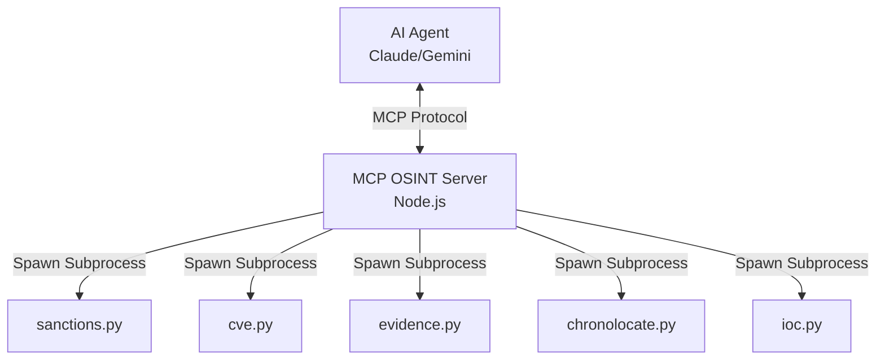

# MCP OSINT Server

This is a Model Context Protocol (MCP) server that exposes powerful Open Source Intelligence (OSINT) tools to AI agents.

## Why MCP?
The Model Context Protocol (MCP) allows AI agents like Claude and Gemini to access external tools in a standardized way. By exposing OSINT tools via MCP, AI agents can perform automated threat intelligence, vulnerability analysis, and digital forensics directly from their chat interfaces.

## Tools Exposed

| Tool | Description | Input | Output |
|------|-------------|-------|--------|
| `sanctions_screen` | Screen a name against EU sanctions lists | `{ name: string, birth_year?: number }` | `{ matches: Array<{listed_name, score, reasons[]}>, total_screened: number }` |
| `cve_brief` | Get prioritized vulnerability brief | `{ watchlist?: string[], max_items?: number, lang?: 'en'\|'nl'\|'es' }` | `{ priorities: {act_now: [], this_week: [], watch: []}, generated_at: string }` |
| `evidence_verify` | Verify evidence chain integrity | `{ case_id: string, evidence_dir: string }` | `{ verified: boolean, chain_length: number, broken_links: string[] }` |
| `chronolocate_sun` | Calculate sun position for verification | `{ lat: number, lon: number, time: string }` | `{ azimuth: number, elevation: number, shadow_bearing: number, shadow_ratio: number }` |
| `ioc_search` | Search indicators of compromise | `{ query: string, type?: 'ip'\|'domain'\|'hash'\|'url' }` | `{ results: Array<{value, type, source, first_seen, tags[]}> }` |

## Installation & Usage

1. Build the server:
   ```bash
   pnpm install
   pnpm build
   ```

2. Add to your AI Agent's configuration (e.g. `claude_desktop_config.json`):
   ```json
   {
     "mcpServers": {
       "osint": {
         "command": "node",
         "args": ["/path/to/mcp-osint-server/dist/index.js"]
       }
     }
   }
   ```

## Architecture



## Scope & Limitations
- These tools are thin wrappers around underlying Python tools. The Python tools must be installed and accessible in the environment.
- The server currently executes Python scripts as subprocesses without maintaining a long-lived Python environment.
